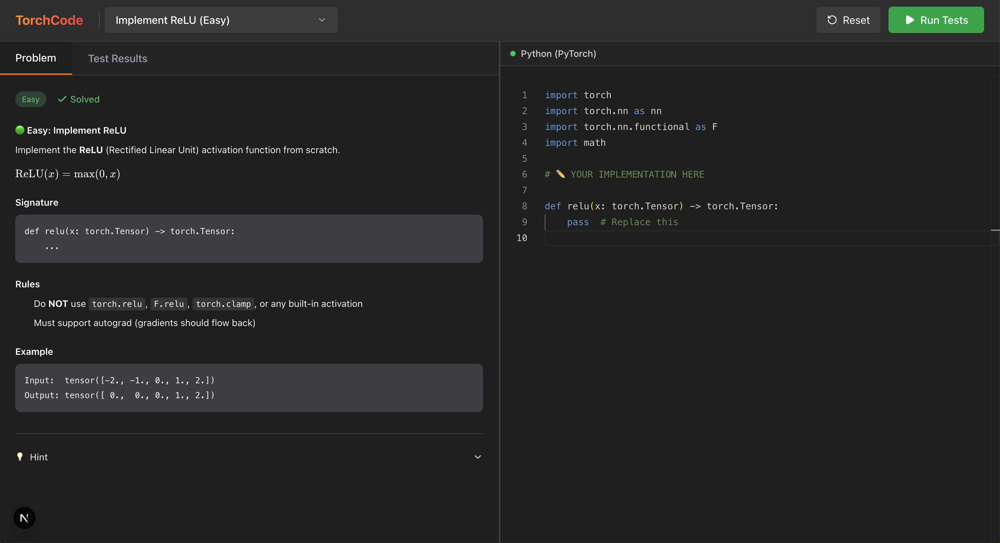

<div align="center">

# 🔥 TorchCode

**Crack the PyTorch interview.**

Practice implementing operators and architectures from scratch — the exact skills top ML teams test for.

*An interactive coding platform, but for tensors. Self-hosted. Jupyter-based. Instant feedback.*

[](https://pytorch.org)
[](https://jupyter.org)
[](https://www.docker.com)
[](https://python.org)
[](LICENSE)

[](https://github.com/duoan/TorchCode)
[](https://ghcr.io/duoan/torchcode)
[](https://huggingface.co/spaces/duoan/TorchCode)


[](https://star-history.com/#duoan/TorchCode&Date)

</div>

---

## 🎯 Why TorchCode?

Top companies (Meta, Google DeepMind, OpenAI, etc.) expect ML engineers to implement core operations **from memory on a whiteboard**. Reading papers isn't enough — you need to write `softmax`, `LayerNorm`, `MultiHeadAttention`, and full Transformer blocks code.

TorchCode gives you a **structured practice environment** with:

| | Feature | |
|---|---|---|
| 🧩 | **42 curated problems** | The most frequently asked PyTorch interview topics |
| ⚖️ | **Automated judge** | Correctness checks, gradient verification, and timing |
| 🎨 | **Instant feedback** | Colored pass/fail per test case, just like competitive programming |
| 💡 | **Hints when stuck** | Nudges without full spoilers |
| 📖 | **Reference solutions** | Study optimal implementations after your attempt |
| 📊 | **Progress tracking** | What you've solved, best times, and attempt counts |
| 🔄 | **One-click reset** | Toolbar button to reset any notebook back to its blank template — practice the same problem as many times as you want |
| [](#) | **Open in Colab** | Every notebook has an "Open in Colab" badge + toolbar button — run problems in Google Colab with zero setup |

No cloud. No signup. No GPU needed. Just `make run` — or try it instantly on Hugging Face.

---

## 🚀 Quick Start

### Option 0 — Try it online (zero install)

**[Launch on Hugging Face Spaces](https://huggingface.co/spaces/duoan/TorchCode)** — opens a full JupyterLab environment in your browser. Nothing to install.

Or open any problem directly in Google Colab — every notebook has an [](https://colab.research.google.com/github/lalo/TorchCode/blob/master/templates/01_relu.ipynb) badge.

### Option 0b — Use the judge in Colab (pip)

In Google Colab, install the judge from PyPI so you can run `check(...)` without cloning the repo:

```bash
!pip install torch-judge
```

Then in a notebook cell:

```python
from torch_judge import check, status, hint, reset_progress
status()           # list all problems and your progress
check("relu")      # run tests for the "relu" task
hint("relu")       # show a hint
```

### Option 1 — Pull the pre-built image (fastest)

```bash
docker run -p 8888:8888 -e PORT=8888 ghcr.io/duoan/torchcode:latest
```

If the registry image is unavailable for your platform, use Option 2 instead. This is the common path on Apple Silicon / `arm64`.

### Option 2 — Build locally

```bash
make run
```

`make run` will try the prebuilt image first and automatically fall back to a local build when needed.

Open **<http://localhost:8888>** — that's it. Works with both Docker and Podman (auto-detected).

### Option 3 — Standalone Web UI (Next.js + FastAPI)

For a modern, standalone coding experience with an integrated IDE and dual-pane layout:

1. **Start Backend (FastAPI):**
   ```bash
   pip install -r api/requirements.txt
   python -m uvicorn api.main:app --port 8000 --reload
   ```
2. **Start Frontend (Next.js):**
   ```bash
   cd web
   npm install
   npm run dev
   ```
3. Open **<http://localhost:3000>** in your browser.



---

## 📋 Problem Set

> **Frequency**: 🔥 = very likely in interviews, ⭐ = commonly asked, 💡 = emerging / differentiator

### 🔵 Prerequisites: PyTorch skills the problems assume

New to PyTorch, or rusty? Start here. Each prerequisite is a short lesson followed by mini-exercises taken from real problems. Follow **[LEARNING_PATH.md](LEARNING_PATH.md)** for the recommended problem order, and see [CURRICULUM.md](CURRICULUM.md) for the reasoning behind it.

| # | Prerequisite | Exercises | Unlocks |
|:---:|---|---|---|
| P1 | <a href="templates/00_p01_tensor_basics.ipynb" target="_blank">Tensor Basics</a> <a href="https://colab.research.google.com/github/lalo/TorchCode/blob/master/templates/00_p01_tensor_basics.ipynb" target="_blank"></a> | `positive_mask`, `running_max_init`, `scale_inplace_`, `quantize_int8`, `fan_in_out` | #01, #07, #12, #13, #15, #19, #20, #21, #24, #25, #29, #36 |
| P2 | <a href="templates/00_p02_broadcasting.ipynb" target="_blank">Broadcasting</a> <a href="https://colab.research.google.com/github/lalo/TorchCode/blob/master/templates/00_p02_broadcasting.ipynb" target="_blank"></a> | `add_channel_bias`, `scale_rows`, `abs_distance_matrix`, `relative_position`, `outer_angles`, `pairwise_sq_dists` | #04, #07, #08, #09, #11, #13, #22, #24, #28, #40, #42 |
| P3 | <a href="templates/00_p03_reductions.ipynb" target="_blank">Reductions Along Dims</a> <a href="https://colab.research.google.com/github/lalo/TorchCode/blob/master/templates/00_p03_reductions.ipynb" target="_blank"></a> | `stable_shift`, `normalize_rows`, `channel_stats`, `masked_mean`, `global_l2_norm`, `exclusive_cumsum` | #02, #04, #07, #08, #12, #21, #25, #32, #36, #38, #41, #42 |
| P4 | <a href="templates/00_p04_indexing_masking.ipynb" target="_blank">Indexing & Masking</a> <a href="https://colab.research.google.com/github/lalo/TorchCode/blob/master/templates/00_p04_indexing_masking.ipynb" target="_blank"></a> | `pick_per_row`, `attention_mask`, `apply_mask`, `keep_topk`, `unsort`, `group_mean` | #09, #11, #13, #14, #16, #18, #24, #28, #32, #38 |
| P5 | <a href="templates/00_p05_shape_manipulation.ipynb" target="_blank">Shape Manipulation</a> <a href="https://colab.research.google.com/github/lalo/TorchCode/blob/master/templates/00_p05_shape_manipulation.ipynb" target="_blank"></a> | `split_heads`, `merge_heads`, `repeat_kv`, `interleave`, `patchify`, `sliding_windows` | #06, #10, #13, #14, #22, #23, #24, #27, #28 |
| P6 | <a href="templates/00_p06_matmul_einsum.ipynb" target="_blank">Matmul & Einsum</a> <a href="https://colab.research.google.com/github/lalo/TorchCode/blob/master/templates/00_p06_matmul_einsum.ipynb" target="_blank"></a> | `linear_forward`, `attention_scores`, `patch_conv`, `qkv_reassociated`, `lora_forward` | #03, #05, #06, #09, #12, #22, #23, #26, #36, #40 |
| P7 | <a href="templates/00_p07_autograd.ipynb" target="_blank">Autograd Essentials</a> <a href="https://colab.research.google.com/github/lalo/TorchCode/blob/master/templates/00_p07_autograd.ipynb" target="_blank"></a> | `grad_of`, `sgd_step_`, `stop_gradient_mse`, `accumulate_grads`, `straight_through_round` | #07, #20, #21, #29, #31, #37, #38, #39, #40, #41, #42 |
| P8 | <a href="templates/00_p08_nn_module.ipynb" target="_blank">nn.Module Anatomy</a> <a href="https://colab.research.google.com/github/lalo/TorchCode/blob/master/templates/00_p08_nn_module.ipynb" target="_blank"></a> | `ScaleShift`, `RunningMean`, `MLPStack`, `freeze_`, `num_trainable` | #03, #13, #14, #15, #17, #18, #23, #26, #27, #28, #36 |
| P9 | <a href="templates/00_p09_numerical_stability.ipynb" target="_blank">Numerical Stability & Log-Space</a> <a href="https://colab.research.google.com/github/lalo/TorchCode/blob/master/templates/00_p09_numerical_stability.ipynb" target="_blank"></a> | `stable_logsumexp`, `log_softmax`, `log_sigmoid`, `kl_from_logits`, `safe_masked_softmax`, `merge_softmax_stats` | #02, #16, #25, #32, #33, #34, #37, #38, #39, #41 |
| P10 | <a href="templates/00_p10_training_loop.ipynb" target="_blank">Training Loop & Randomness</a> <a href="https://colab.research.google.com/github/lalo/TorchCode/blob/master/templates/00_p10_training_loop.ipynb" target="_blank"></a> | `train_steps`, `set_lr_`, `keep_mask`, `sample_tokens`, `shuffled_batches` | #17, #29, #30, #31, #32, #34, #40 |

Together the ten prerequisites cover every PyTorch skill the 42 problems use; see [CURRICULUM.md](CURRICULUM.md) for the mapping.

### ⭐ Bonus: beyond the problems

Optional notebooks on techniques that come up in interviews and real codebases but that no problem requires. Each one ends with problems to re-solve using it.

<!-- bonus-table:start -->
| # | Bonus | Exercises | Try it on |
|:---:|---|---|---|
| B1 | <a href="templates/00_b01_custom_autograd.ipynb" target="_blank">Custom Autograd Functions</a> <a href="https://colab.research.google.com/github/lalo/TorchCode/blob/master/templates/00_b01_custom_autograd.ipynb" target="_blank"></a> | `ReLUFn`, `SigmoidFn`, `LinearFn`, `SoftmaxFn`, `FakeQuantFn` | #01, #02, #03, #16, #19, #36 |
| B2 | <a href="templates/00_b02_debugging.ipynb" target="_blank">Debugging & Testing Tensors</a> <a href="https://colab.research.google.com/github/lalo/TorchCode/blob/master/templates/00_b02_debugging.ipynb" target="_blank"></a> | `first_nan_module`, `params_without_grad`, `diff_report`, `grad_norms_by_name` | #13, #21, #25, #26, #28 |
| B4 | <a href="templates/00_b04_sequence_batching.ipynb" target="_blank">Sequence Batching</a> <a href="https://colab.research.google.com/github/lalo/TorchCode/blob/master/templates/00_b04_sequence_batching.ipynb" target="_blank"></a> | `pad_batch`, `padding_mask`, `attention_mask_padded`, `next_token_batch`, `masked_token_loss` | #09, #13, #14, #16, #41 |
<!-- bonus-table:end -->

### 🧱 Fundamentals — "Implement X from scratch"

The bread and butter of ML coding interviews. You'll be asked to write these without `torch.nn`.

| # | Problem | What You'll Implement | Difficulty | Freq | Key Concepts |
|:---:|---------|----------------------|:----------:|:----:|--------------|
| 1 | <a href="templates/01_relu.ipynb" target="_blank">ReLU</a> <a href="https://colab.research.google.com/github/lalo/TorchCode/blob/master/templates/01_relu.ipynb" target="_blank"></a> | `relu(x)` |  | 🔥 | Activation functions, element-wise ops |
| 2 | <a href="templates/02_softmax.ipynb" target="_blank">Softmax</a> <a href="https://colab.research.google.com/github/lalo/TorchCode/blob/master/templates/02_softmax.ipynb" target="_blank"></a> | `my_softmax(x, dim)` |  | 🔥 | Numerical stability, exp/log tricks |
| 16 | <a href="templates/16_cross_entropy.ipynb" target="_blank">Cross-Entropy Loss</a> <a href="https://colab.research.google.com/github/lalo/TorchCode/blob/master/templates/16_cross_entropy.ipynb" target="_blank"></a> | `cross_entropy_loss(logits, targets)` |  | 🔥 | Log-softmax, logsumexp trick |
| 17 | <a href="templates/17_dropout.ipynb" target="_blank">Dropout</a> <a href="https://colab.research.google.com/github/lalo/TorchCode/blob/master/templates/17_dropout.ipynb" target="_blank"></a> | `MyDropout` (nn.Module) |  | 🔥 | Train/eval mode, inverted scaling |
| 18 | <a href="templates/18_embedding.ipynb" target="_blank">Embedding</a> <a href="https://colab.research.google.com/github/lalo/TorchCode/blob/master/templates/18_embedding.ipynb" target="_blank"></a> | `MyEmbedding` (nn.Module) |  | 🔥 | Lookup table, `weight[indices]` |
| 19 | <a href="templates/19_gelu.ipynb" target="_blank">GELU</a> <a href="https://colab.research.google.com/github/lalo/TorchCode/blob/master/templates/19_gelu.ipynb" target="_blank"></a> | `my_gelu(x)` |  | ⭐ | Gaussian error linear unit, `torch.erf` |
| 20 | <a href="templates/20_weight_init.ipynb" target="_blank">Kaiming Init</a> <a href="https://colab.research.google.com/github/lalo/TorchCode/blob/master/templates/20_weight_init.ipynb" target="_blank"></a> | `kaiming_init(weight)` |  | ⭐ | `std = sqrt(2/fan_in)`, variance scaling |
| 21 | <a href="templates/21_gradient_clipping.ipynb" target="_blank">Gradient Clipping</a> <a href="https://colab.research.google.com/github/lalo/TorchCode/blob/master/templates/21_gradient_clipping.ipynb" target="_blank"></a> | `clip_grad_norm(params, max_norm)` |  | ⭐ | Norm-based clipping, direction preservation |
| 31 | <a href="templates/31_gradient_accumulation.ipynb" target="_blank">Gradient Accumulation</a> <a href="https://colab.research.google.com/github/lalo/TorchCode/blob/master/templates/31_gradient_accumulation.ipynb" target="_blank"></a> | `accumulated_step(model, opt, ...)` |  | 💡 | Micro-batching, loss scaling |
| 40 | <a href="templates/40_linear_regression.ipynb" target="_blank">Linear Regression</a> <a href="https://colab.research.google.com/github/lalo/TorchCode/blob/master/templates/40_linear_regression.ipynb" target="_blank"></a> | `LinearRegression` (3 methods) |  | 🔥 | Normal equation, GD from scratch, nn.Linear |
| 3 | <a href="templates/03_linear.ipynb" target="_blank">Linear Layer</a> <a href="https://colab.research.google.com/github/lalo/TorchCode/blob/master/templates/03_linear.ipynb" target="_blank"></a> | `SimpleLinear` (nn.Module) |  | 🔥 | `y = xW^T + b`, `1/√fan_in` init, `nn.Parameter` |
| 4 | <a href="templates/04_layernorm.ipynb" target="_blank">LayerNorm</a> <a href="https://colab.research.google.com/github/lalo/TorchCode/blob/master/templates/04_layernorm.ipynb" target="_blank"></a> | `my_layer_norm(x, γ, β)` |  | 🔥 | Normalization, running stats, affine transform |
| 7 | <a href="templates/07_batchnorm.ipynb" target="_blank">BatchNorm</a> <a href="https://colab.research.google.com/github/lalo/TorchCode/blob/master/templates/07_batchnorm.ipynb" target="_blank"></a> | `my_batch_norm(x, γ, β)` |  | ⭐ | Batch vs layer statistics, train/eval behavior |
| 42 | <a href="templates/42_batchnorm2d.ipynb" target="_blank">BatchNorm2d</a> <a href="https://colab.research.google.com/github/lalo/TorchCode/blob/master/templates/42_batchnorm2d.ipynb" target="_blank"></a> | `my_batch_norm2d(x, γ, β)` |  | ⭐ | Per-channel stats over (N, H, W), `(1, C, 1, 1)` broadcasting, Bessel correction over N·H·W |
| 8 | <a href="templates/08_rmsnorm.ipynb" target="_blank">RMSNorm</a> <a href="https://colab.research.google.com/github/lalo/TorchCode/blob/master/templates/08_rmsnorm.ipynb" target="_blank"></a> | `rms_norm(x, weight)` |  | ⭐ | LLaMA-style norm, simpler than LayerNorm |
| 15 | <a href="templates/15_mlp.ipynb" target="_blank">SwiGLU MLP</a> <a href="https://colab.research.google.com/github/lalo/TorchCode/blob/master/templates/15_mlp.ipynb" target="_blank"></a> | `SwiGLUMLP` (nn.Module) |  | ⭐ | Gated FFN, `SiLU(gate) * up`, LLaMA/Mistral-style |
| 22 | <a href="templates/22_conv2d.ipynb" target="_blank">Conv2d</a> <a href="https://colab.research.google.com/github/lalo/TorchCode/blob/master/templates/22_conv2d.ipynb" target="_blank"></a> | `my_conv2d(x, weight, ...)` |  | 🔥 | Convolution, unfold, stride/padding |

### 🧠 Attention Mechanisms — The heart of modern ML interviews

If you're interviewing for any role touching LLMs or Transformers, expect at least one of these.

| # | Problem | What You'll Implement | Difficulty | Freq | Key Concepts |
|:---:|---------|----------------------|:----------:|:----:|--------------|
| 5 | <a href="templates/05_attention.ipynb" target="_blank">Scaled Dot-Product Attention</a> <a href="https://colab.research.google.com/github/lalo/TorchCode/blob/master/templates/05_attention.ipynb" target="_blank"></a> | `scaled_dot_product_attention(Q, K, V)` |  | 🔥 | `softmax(QK^T/√d_k)V`, the foundation of everything |
| 6 | <a href="templates/06_multihead_attention.ipynb" target="_blank">Multi-Head Attention</a> <a href="https://colab.research.google.com/github/lalo/TorchCode/blob/master/templates/06_multihead_attention.ipynb" target="_blank"></a> | `MultiHeadAttention` (nn.Module) |  | 🔥 | Parallel heads, split/concat, projection matrices |
| 23 | <a href="templates/23_cross_attention.ipynb" target="_blank">Cross-Attention</a> <a href="https://colab.research.google.com/github/lalo/TorchCode/blob/master/templates/23_cross_attention.ipynb" target="_blank"></a> | `MultiHeadCrossAttention` (nn.Module) |  | ⭐ | Encoder-decoder, Q from decoder, K/V from encoder |
| 9 | <a href="templates/09_causal_attention.ipynb" target="_blank">Causal Self-Attention</a> <a href="https://colab.research.google.com/github/lalo/TorchCode/blob/master/templates/09_causal_attention.ipynb" target="_blank"></a> | `causal_attention(Q, K, V)` |  | 🔥 | Autoregressive masking with `-inf`, GPT-style |
| 10 | <a href="templates/10_gqa.ipynb" target="_blank">Grouped Query Attention</a> <a href="https://colab.research.google.com/github/lalo/TorchCode/blob/master/templates/10_gqa.ipynb" target="_blank"></a> | `GroupQueryAttention` (nn.Module) |  | ⭐ | GQA (LLaMA 2), KV sharing across heads |
| 11 | <a href="templates/11_sliding_window.ipynb" target="_blank">Sliding Window Attention</a> <a href="https://colab.research.google.com/github/lalo/TorchCode/blob/master/templates/11_sliding_window.ipynb" target="_blank"></a> | `sliding_window_attention(Q, K, V, w)` |  | ⭐ | Bidirectional (Longformer-style) local attention, O(n·w) complexity |
| 12 | <a href="templates/12_linear_attention.ipynb" target="_blank">Linear Attention</a> <a href="https://colab.research.google.com/github/lalo/TorchCode/blob/master/templates/12_linear_attention.ipynb" target="_blank"></a> | `linear_attention(Q, K, V)` |  | 💡 | Kernel trick, `φ(Q)(φ(K)^TV)`, O(n·d²) |
| 14 | <a href="templates/14_kv_cache.ipynb" target="_blank">KV Cache Attention</a> <a href="https://colab.research.google.com/github/lalo/TorchCode/blob/master/templates/14_kv_cache.ipynb" target="_blank"></a> | `KVCacheAttention` (nn.Module) |  | 🔥 | Incremental decoding, cache K/V, prefill vs decode |
| 24 | <a href="templates/24_rope.ipynb" target="_blank">RoPE</a> <a href="https://colab.research.google.com/github/lalo/TorchCode/blob/master/templates/24_rope.ipynb" target="_blank"></a> | `apply_rope(q, k)` |  | 🔥 | Rotary position embedding, relative position via rotation |
| 25 | <a href="templates/25_flash_attention.ipynb" target="_blank">Flash Attention</a> <a href="https://colab.research.google.com/github/lalo/TorchCode/blob/master/templates/25_flash_attention.ipynb" target="_blank"></a> | `flash_attention(Q, K, V, block_size)` |  | 💡 | Tiled attention, online softmax, memory-efficient |

### 🏗️ Architecture & Adaptation — Put it all together

| # | Problem | What You'll Implement | Difficulty | Freq | Key Concepts |
|:---:|---------|----------------------|:----------:|:----:|--------------|
| 26 | <a href="templates/26_lora.ipynb" target="_blank">LoRA</a> <a href="https://colab.research.google.com/github/lalo/TorchCode/blob/master/templates/26_lora.ipynb" target="_blank"></a> | `LoRALinear` (nn.Module) |  | ⭐ | Low-rank adaptation, frozen base + `BA` update |
| 27 | <a href="templates/27_vit_patch.ipynb" target="_blank">ViT Patch Embedding</a> <a href="https://colab.research.google.com/github/lalo/TorchCode/blob/master/templates/27_vit_patch.ipynb" target="_blank"></a> | `PatchEmbedding` (nn.Module) |  | 💡 | Image → patches → linear projection |
| 13 | <a href="templates/13_gpt2_block.ipynb" target="_blank">GPT-2 Block</a> <a href="https://colab.research.google.com/github/lalo/TorchCode/blob/master/templates/13_gpt2_block.ipynb" target="_blank"></a> | `GPT2Block` (nn.Module) |  | ⭐ | Pre-norm, causal MHA + MLP (4x, GELU), residual connections |
| 28 | <a href="templates/28_moe.ipynb" target="_blank">Mixture of Experts</a> <a href="https://colab.research.google.com/github/lalo/TorchCode/blob/master/templates/28_moe.ipynb" target="_blank"></a> | `MixtureOfExperts` (nn.Module) |  | ⭐ | Mixtral-style, top-k routing, expert MLPs |

### ⚙️ Training & Optimization

| # | Problem | What You'll Implement | Difficulty | Freq | Key Concepts |
|:---:|---------|----------------------|:----------:|:----:|--------------|
| 30 | <a href="templates/30_cosine_lr.ipynb" target="_blank">Cosine LR Scheduler</a> <a href="https://colab.research.google.com/github/lalo/TorchCode/blob/master/templates/30_cosine_lr.ipynb" target="_blank"></a> | `cosine_lr_schedule(step, ...)` |  | ⭐ | Linear warmup + cosine annealing |
| 29 | <a href="templates/29_adam.ipynb" target="_blank">Adam Optimizer</a> <a href="https://colab.research.google.com/github/lalo/TorchCode/blob/master/templates/29_adam.ipynb" target="_blank"></a> | `MyAdam` |  | ⭐ | Momentum + RMSProp, bias correction |

### 🎯 Inference & Decoding

| # | Problem | What You'll Implement | Difficulty | Freq | Key Concepts |
|:---:|---------|----------------------|:----------:|:----:|--------------|
| 32 | <a href="templates/32_topk_sampling.ipynb" target="_blank">Top-k / Top-p Sampling</a> <a href="https://colab.research.google.com/github/lalo/TorchCode/blob/master/templates/32_topk_sampling.ipynb" target="_blank"></a> | `sample_top_k_top_p(logits, ...)` |  | 🔥 | Nucleus sampling, temperature scaling |
| 33 | <a href="templates/33_beam_search.ipynb" target="_blank">Beam Search</a> <a href="https://colab.research.google.com/github/lalo/TorchCode/blob/master/templates/33_beam_search.ipynb" target="_blank"></a> | `beam_search(log_prob_fn, ...)` |  | 🔥 | Hypothesis expansion, pruning, eos handling |
| 34 | <a href="templates/34_speculative_decoding.ipynb" target="_blank">Speculative Decoding</a> <a href="https://colab.research.google.com/github/lalo/TorchCode/blob/master/templates/34_speculative_decoding.ipynb" target="_blank"></a> | `speculative_decode(target, draft, ...)` |  | 💡 | Accept/reject, draft model acceleration |

### 🔬 Advanced — Differentiators

| # | Problem | What You'll Implement | Difficulty | Freq | Key Concepts |
|:---:|---------|----------------------|:----------:|:----:|--------------|
| 35 | <a href="templates/35_bpe.ipynb" target="_blank">BPE Tokenizer</a> <a href="https://colab.research.google.com/github/lalo/TorchCode/blob/master/templates/35_bpe.ipynb" target="_blank"></a> | `SimpleBPE` |  | 💡 | Byte-pair encoding, merge rules, subword splits |
| 36 | <a href="templates/36_int8_quantization.ipynb" target="_blank">INT8 Quantization</a> <a href="https://colab.research.google.com/github/lalo/TorchCode/blob/master/templates/36_int8_quantization.ipynb" target="_blank"></a> | `Int8Linear` (nn.Module) |  | 💡 | Per-channel quantize, scale/zero-point, buffer vs param |
| 37 | <a href="templates/37_dpo_loss.ipynb" target="_blank">DPO Loss</a> <a href="https://colab.research.google.com/github/lalo/TorchCode/blob/master/templates/37_dpo_loss.ipynb" target="_blank"></a> | `dpo_loss(chosen, rejected, ...)` |  | 💡 | Direct preference optimization, alignment training |
| 38 | <a href="templates/38_grpo_loss.ipynb" target="_blank">GRPO Loss</a> <a href="https://colab.research.google.com/github/lalo/TorchCode/blob/master/templates/38_grpo_loss.ipynb" target="_blank"></a> | `grpo_loss(logps, rewards, group_ids, eps)` |  | 💡 | Group relative policy optimization, RL fine-tuning, within-group normalized advantages |
| 39 | <a href="templates/39_ppo_loss.ipynb" target="_blank">PPO Loss</a> <a href="https://colab.research.google.com/github/lalo/TorchCode/blob/master/templates/39_ppo_loss.ipynb" target="_blank"></a> | `ppo_loss(new_logps, old_logps, advantages, clip_ratio)` |  | 💡 | PPO clipped surrogate loss, policy gradient, trust region |
| 41 | <a href="templates/41_opd_loss.ipynb" target="_blank">OPD Loss</a> <a href="https://colab.research.google.com/github/lalo/TorchCode/blob/master/templates/41_opd_loss.ipynb" target="_blank"></a> | `opd_loss(student_logits, teacher_logits, ...)` |  | 💡 | On-policy distillation, reverse KL, multi-teacher alignment |

---

## ⚙️ How It Works

Each problem has **two** notebooks:

| File | Purpose |
|------|---------|
| `01_relu.ipynb` | ✏️ Blank template — write your code here |
| `01_relu_solution.ipynb` | 📖 Reference solution — check when stuck |

### Workflow

```text
1. Open a blank notebook           →  Read the problem description
2. Implement your solution         →  Use only basic PyTorch ops
3. Debug freely                    →  print(x.shape), check gradients, etc.
4. Run the judge cell              →  check("relu")
5. See instant colored feedback    →  ✅ pass / ❌ fail per test case
6. Stuck? Get a nudge              →  hint("relu")
7. Review the reference solution   →  01_relu_solution.ipynb
8. Click 🔄 Reset in the toolbar  →  Blank slate — practice again!
```

**Prerequisite notebooks** (`00_pXX_*.ipynb`) follow the same loop with a few differences: a short lesson comes first, there are several ✏️ cells (one per exercise), and a single `check("p02_broadcasting")` grades every exercise, with each test named after its exercise. `hint(...)` gives one hint per exercise. They're optional, so skip any skill you already know.

### In-Notebook API

```python
from torch_judge import check, hint, status

check("relu")               # Judge your implementation
hint("causal_attention")    # Get a hint without full spoiler
status()                    # Progress dashboard — solved / attempted / todo
```

---

## 📅 Suggested Study Plan

> **Total: ~12–16 hours spread across 3–4 weeks. Perfect for interview prep on a deadline.**

> New to PyTorch? Do the [prerequisites](#-prerequisites-pytorch-skills-the-problems-assume) first, or follow [LEARNING_PATH.md](LEARNING_PATH.md), which orders all 41 problems by the skills they build on.

| Week | Focus | Problems | Time |
|:----:|-------|----------|:----:|
| **1** | 🧱 Foundations | ReLU → Softmax → CE Loss → Dropout → Embedding → GELU → Linear → LayerNorm → BatchNorm → BatchNorm2d → RMSNorm → SwiGLU MLP → Conv2d | 2–3 hrs |
| **2** | 🧠 Attention Deep Dive | SDPA → MHA → Cross-Attn → Causal → GQA → KV Cache → Sliding Window → RoPE → Linear Attn → Flash Attn | 3–4 hrs |
| **3** | 🏗️ Architecture + Training | GPT-2 Block → LoRA → MoE → ViT Patch → Adam → Cosine LR → Grad Clip → Grad Accumulation → Kaiming Init | 3–4 hrs |
| **4** | 🎯 Inference + Advanced | Top-k/p Sampling → Beam Search → Speculative Decoding → BPE → INT8 Quant → DPO Loss → GRPO Loss → PPO Loss → OPD Loss + speed run | 3–4 hrs |

---

## 🏛️ Architecture

```text
┌──────────────────────────────────────────┐
│           Docker / Podman Container      │
│                                          │
│  JupyterLab (:8888)                      │
│    ├── templates/  (reset on each run)   │
│    ├── solutions/  (reference impl)      │
│    ├── torch_judge/ (auto-grading)       │
│    ├── torchcode-labext (JLab plugin)    │
│    │     🔄 Reset — restore template     │
│    │     🔗 Colab — open in Colab        │
│    └── PyTorch (CPU), NumPy              │
│                                          │
│  Judge checks:                           │
│    ✓ Output correctness (allclose)       │
│    ✓ Gradient flow (autograd)            │
│    ✓ Shape consistency                   │
│    ✓ Edge cases & numerical stability    │
└──────────────────────────────────────────┘
```

Single container. Single port. No database. No frontend framework. No GPU.

## 🛠️ Commands

```bash
make run    # Build & start (http://localhost:8888)
make stop   # Stop the container
make clean  # Stop + remove volumes + reset all progress
```

Contributors editing prerequisite notebooks (see [below](#adding-a-prerequisite-notebook)):

```bash
make prereqs          # Regenerate prerequisite notebooks + LEARNING_PATH.md
make prereqs-verify   # Check outputs are up to date, solutions pass, blank stubs fail (needs PyTorch)
```

### Hosting your own copy (fork or mirror)

Links between files in this repo are relative, so they work anywhere. **"Open in Colab" badges can't be relative**: Colab opens notebooks by `owner/repo/branch` on GitHub. The repo they point at is set in one place, [`repo.json`](repo.json):

```json
{ "github_repo": "your-name/TorchCode", "branch": "master" }
```

Then run:

```bash
make repo-links         # Rewrite every Colab badge / GitHub file link (README, notebooks, lab extension) and regenerate
make repo-links-check   # Fail if any link still points elsewhere (useful in CI)
```

Links that identify the upstream project itself (the Docker image, Hugging Face Space, stars badge, contributors) are intentionally left unchanged.

## 🧩 Adding Your Own Problems

TorchCode uses auto-discovery — just drop a new file in `torch_judge/tasks/`:

```python
TASK = {
    "id": "my_task",
    "title": "My Custom Problem",
    "difficulty": "medium",
    "function_name": "my_function",
    "hint": "Think about broadcasting...",
    "tests": [ ... ],
}
```

No registration needed. The judge picks it up automatically.

### Adding a prerequisite notebook

Prerequisite notebooks (`templates/00_pXX_*.ipynb`, their solutions, and `LEARNING_PATH.md`) are **generated**. Don't edit them in Jupyter; the next build overwrites your changes. Instead:

1. Write the judge task in `torch_judge/tasks/pXX_<topic>.py` (list every exercise in `function_names`).
2. Write the notebook content in `scripts/prereqs/content/pXX_<topic>.py`.
3. Run `make prereqs`, then `make prereqs-verify`.

Full details are in [CURRICULUM.md](CURRICULUM.md#adding-a-prerequisite-notebook).

---

## 📦 Publishing `torch-judge` to PyPI (maintainers)

The judge is published as a separate package so Colab/users can `pip install torch-judge` without cloning the repo.

### Automatic (GitHub Action)

Pushing to `master` after changing the package version triggers [`.github/workflows/pypi-publish.yml`](.github/workflows/pypi-publish.yml), which builds and uploads to PyPI. No git tag is required.

1. **Bump version** in `torch_judge/_version.py` (e.g. `__version__ = "0.1.1"`).
2. **Configure PyPI Trusted Publisher** (one-time):
   - PyPI → Your project **torch-judge** → **Publishing** → **Add a new pending publisher**
   - Owner: `duoan`, Repository: `TorchCode`, Workflow: `pypi-publish.yml`, Environment: (leave empty)
   - Run the workflow once (push a version bump to `master` or **Actions → Publish torch-judge to PyPI → Run workflow**); PyPI will then link the publisher.
3. **Release**: commit the version bump and `git push origin master`.

Alternatively, use an API token: add repository secret `PYPI_API_TOKEN` (value = `pypi-...` from PyPI) and set `TWINE_USERNAME=__token__` and `TWINE_PASSWORD` from that secret in the workflow if you prefer not to use Trusted Publishing.

### Manual

```bash
pip install build twine
python -m build
twine upload dist/*
```

Version is in `torch_judge/_version.py`; bump it before each release.

---

## ❓ FAQ

<details>
<summary><b>Do I need a GPU?</b></summary>
<br>
No. Everything runs on CPU. The problems test correctness and understanding, not throughput.
</details>

<details>
<summary><b>Can I keep my solutions between runs?</b></summary>
<br>
Blank templates reset on every <code>make run</code> so you practice from scratch. Save your work under a different filename if you want to keep it. You can also click the <b>🔄 Reset</b> button in the notebook toolbar at any time to restore the blank template without restarting.
</details>

<details>
<summary><b>Can I use Google Colab instead?</b></summary>
<br>
Yes! Every notebook has an <b>Open in Colab</b> badge at the top. Click it to open the problem directly in Google Colab — no Docker or local setup needed. You can also use the <b>Colab</b> toolbar button inside JupyterLab.
</details>

<details>
<summary><b>How are solutions graded?</b></summary>
<br>
The judge runs your function against multiple test cases using <code>torch.allclose</code> for numerical correctness, verifies gradients flow properly via autograd, and checks edge cases specific to each operation.
</details>

<details>
<summary><b>Who is this for?</b></summary>
<br>
Anyone preparing for ML/AI engineering interviews at top tech companies, or anyone who wants to deeply understand how PyTorch operations work under the hood.
</details>

---

## 🤝 Contributors

Thanks to everyone who has contributed to TorchCode.

<!-- readme: contributors -start -->
<table>
	<tbody>
		<tr>
            <td align="center">
                <a href="https://github.com/duoan">
                    
                    <br />
                    <sub><b>duoan</b></sub>
                </a>
            </td>
            <td align="center">
                <a href="https://github.com/Ando233">
                    
                    <br />
                    <sub><b>Ando233</b></sub>
                </a>
            </td>
            <td align="center">
                <a href="https://github.com/abhijitmjj">
                    
                    <br />
                    <sub><b>abhijitmjj</b></sub>
                </a>
            </td>
            <td align="center">
                <a href="https://github.com/laitifranz">
                    
                    <br />
                    <sub><b>laitifranz</b></sub>
                </a>
            </td>
            <td align="center">
                <a href="https://github.com/hrlics">
                    
                    <br />
                    <sub><b>hrlics</b></sub>
                </a>
            </td>
            <td align="center">
                <a href="https://github.com/HareshKarnan">
                    
                    <br />
                    <sub><b>HareshKarnan</b></sub>
                </a>
            </td>
		</tr>
		<tr>
            <td align="center">
                <a href="https://github.com/ThierryHJ">
                    
                    <br />
                    <sub><b>ThierryHJ</b></sub>
                </a>
            </td>
            <td align="center">
                <a href="https://github.com/Zuozhuo">
                    
                    <br />
                    <sub><b>Zuozhuo</b></sub>
                </a>
            </td>
            <td align="center">
                <a href="https://github.com/reidemeister94">
                    
                    <br />
                    <sub><b>reidemeister94</b></sub>
                </a>
            </td>
		</tr>
	<tbody>
</table>
<!-- readme: contributors -end -->

Auto-generated from the [GitHub contributors graph](https://github.com/duoan/TorchCode/graphs/contributors) with avatars and GitHub usernames.

---

<div align="center">

**Built for engineers who want to deeply understand what they build.**

If this helped your interview prep, consider giving it a ⭐

---

### ☕ Buy Me a Coffee

<a href="https://buymeacoffee.com/duoan" target="_blank"></a>


*Scan to support*

</div>
